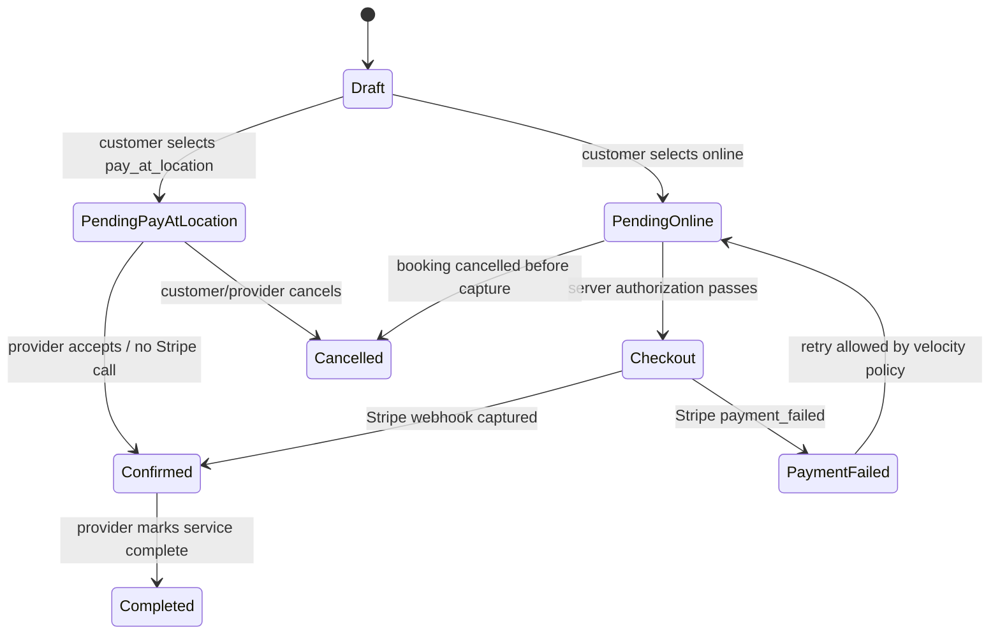
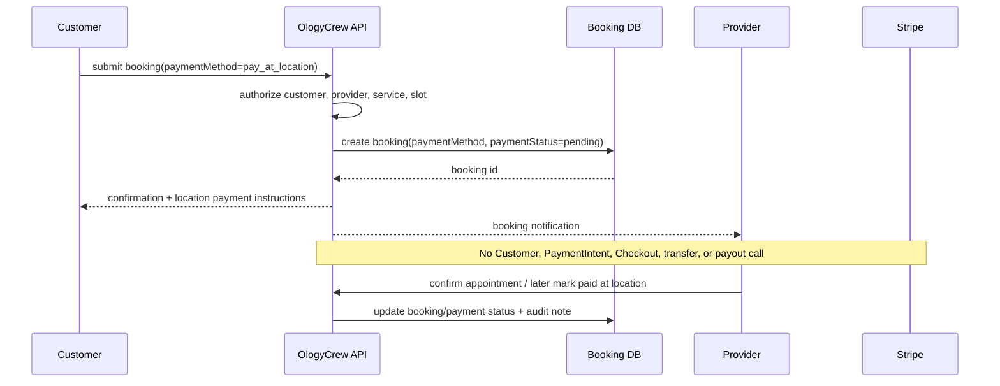

# OlogyCrew Payment Reliability Roadmap

## Stage 2 production-readiness review

### Migration and rollback

Stage 2 uses additive migrations `0068_blushing_katie_power.sql` and `0069_curious_tarantula.sql`. The live database contains `stripe_webhook_events`; no existing payment, booking, subscription, Stripe, bank, payout, incident, or account records were altered. The migration SQL contains one new table, indexes, a unique Stripe event ID, and one additive lease-token column. There is no automatic down migration. The approved rollback is application rollback while retaining the ledger for evidence; dropping the table is a separate destructive action requiring export, quiescence, and explicit approval.

### Validation completed

- Signature verification remains before ledger insertion; invalid signatures create no ledger row.
- Duplicate event IDs are acknowledged without repeating handlers.
- Concurrent claims use the unique event ID and conditional lease acquisition.
- Failed processing is recorded with a sanitized error and retry time.
- Stale leases can be reclaimed after five minutes.
- Completion and failure writes require the current lease token, preventing stale workers from finalizing reclaimed work.
- Captured and refunded payment states are protected from an older failed event.
- Existing event switch cases and charge architecture remain in place.
- TypeScript validation passed.
- Production client/server build passed.
- Focused payment/webhook suite passed 63/63.
- Full regression passed 225 files and 2,286 tests; cleanup succeeded.

### Partial-processing recovery finding

The ledger prevents duplicate event delivery from repeating a handler, but it cannot make an external Stripe side effect and a local database write one atomic transaction. If a handler succeeds at Stripe and fails locally, the event is marked failed and retried. Existing payment tables use Stripe IDs and duplicate-safe upserts; handlers must continue to query Stripe object IDs and preserve terminal states before creating any new side effect. Production monitoring should alert on repeated `failed` rows, stale `processing` rows, and events whose retry count exceeds the operational threshold. Any handler that creates a second external side effect must use its own deterministic Stripe idempotency key.

### Production monitoring and recovery

Monitor counts by status, event type, account, and retry age. Alert on any event processing for more than five minutes, repeated failures after three attempts, or a growing failed queue. Recovery is: preserve the row and error, inspect the corresponding Stripe event and local ledger, correct the underlying handler/configuration, then allow a controlled retry. Do not manually replay a live event until the Stripe security case and the OlogyCrew incident owner approve it. Never delete ledger rows as a first response.

## Stage 3 atomic payment-attempt velocity controls

### Architecture

A server-side `payment_velocity_counters` table uses a unique `(dimension, subjectKey, bucketStart)` key. Each payment attempt atomically increments counters inside a database transaction across account, normalized email, Stripe Customer when known, provider, booking, and client IP dimensions. A threshold breach writes a cooldown timestamp and returns a reversible `TOO_MANY_REQUESTS` response before credits are spent or Stripe customer/session creation occurs. No geographic block is used. The default rules are deliberately scoped to payment attempts, not browsing or legitimate non-payment booking activity.

Default ten-minute thresholds are account 8, email 8, Stripe Customer 8, provider 40, booking 5, and IP 20, with a 30-minute cooldown. Rules are loaded from the admin-managed `platform_settings` key `payment_velocity_rules`, so an administrator can disable or tune the control without a code deploy. Block decisions are recorded in the existing audit log without storing raw card data or full sensitive identifiers.

The shared gate is wired into booking Checkout, provider promotions, invoice payment links, customer subscriptions, and provider subscriptions. Booking adds all six dimensions when the Stripe Customer is known; other routes add every dimension available before their Stripe side effect. The shared payment authorization boundary remains responsible for account suspension, provider ownership, subscription entitlement, payout readiness, booking ownership, and server-calculated amounts. Stripe architecture, payout settings, connected accounts, and bank settings are unchanged. Synthetic Vitest calls bypass counter writes only in the test runtime so repository fixtures cannot contaminate live counters; preview and production remain enforced.

### Migration

Generate and review an additive migration for `payment_velocity_counters`. Apply only `CREATE TABLE` and indexes. Before production use, back up the database metadata and verify the live schema matches Drizzle. Rollback is application rollback while retaining counters; dropping the counter table is optional, destructive, and requires preserving an export first.

### Acceptance tests

- 50 concurrent synthetic attempts for one booking produce one atomic counter sequence and no duplicate Stripe session due to existing idempotency.
- Account, email, Customer, provider, booking, and IP dimensions are each enforced.
- A threshold breach occurs before credit spending, customer creation, or Checkout session creation.
- Cooldown is enforced and expires predictably.
- Disabling `payment_velocity_rules.enabled` restores payment access without deleting counters.
- Different customers sharing a provider are not blanket-blocked by one customer’s account counter.
- No location or country rule is used.
- Block decisions are auditable and contain no raw card data.

## Stage 4 pay-at-location design

Pay-at-location is a separate booking payment method, not a Stripe failure state. Add a booking-level `paymentMethod` enum such as `online`, `pay_at_location`, and `complimentary`, plus independent `paymentStatus` values such as `not_required`, `pending`, `authorized`, `captured`, `failed`, `refunded`, and `cancelled`. Existing online rows remain unchanged through a nullable additive migration.

The pay-at-location flow creates or confirms the booking, records `paymentMethod = pay_at_location` and `paymentStatus = pending`, and never calls Stripe Checkout, PaymentIntent creation, Customer creation, credits spending, transfer creation, or payout logic. Provider confirmation and customer reminders clearly state that payment is due at the provider’s location. Completion can be recorded by an authorized provider/admin action, with optional amount and receipt notes; it must not fabricate a Stripe payment row.

Applicable categories include salons, barbers, dental and eye care, auto services, fitness, massage, home services, events, photography, DJs, and other providers that explicitly accept payment at location. The UI must show the option only when the provider enables it. Provider settings should include a reversible `acceptsPayAtLocation` flag and a short payment instruction. The booking confirmation, reminders, provider calendar, admin booking view, and reporting must display payment method separately from booking status.

### Booking/payment state machine

The booking status and payment status are independent: a pay-at-location booking can be `confirmed` while its payment status remains `pending`, and an online booking can be `confirmed` only after its payment status is `captured` or an approved non-Stripe method is recorded.

### No-Stripe pay-at-location sequence

Required diagrams and tests before implementation: booking/payment state machine, no-Stripe-call contract test, provider opt-in/opt-out test, customer ownership test, duplicate submission test, cancellation/refund semantics, reminder copy test, admin audit test, and migration backfill verification. Stage 4 remains design-only in this checkpoint.
