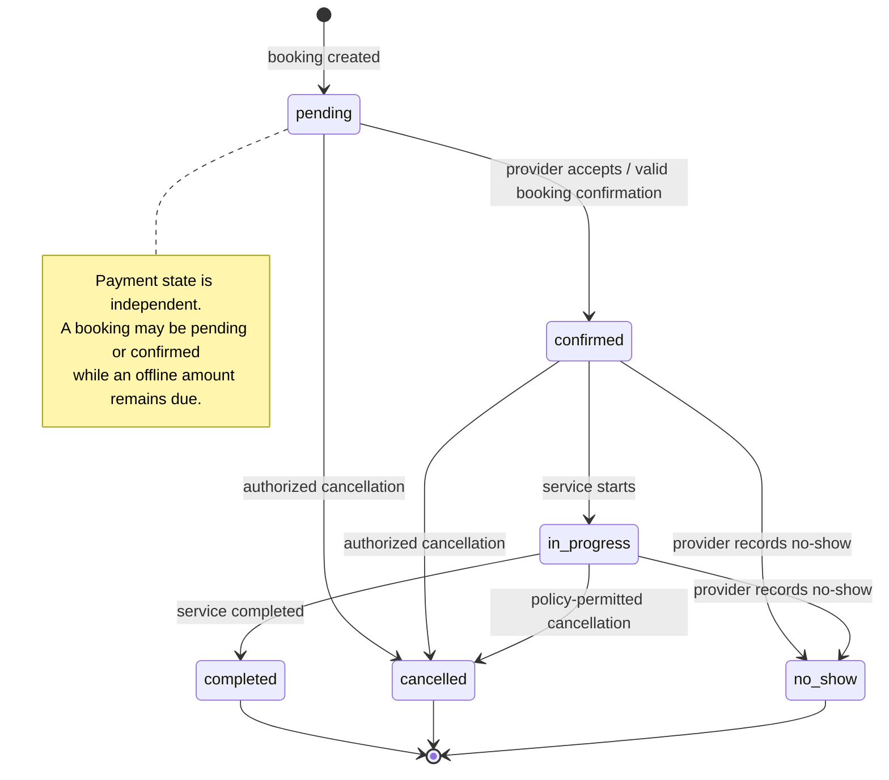
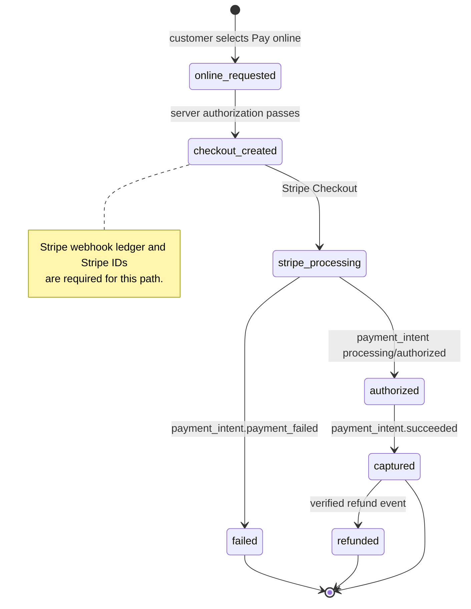
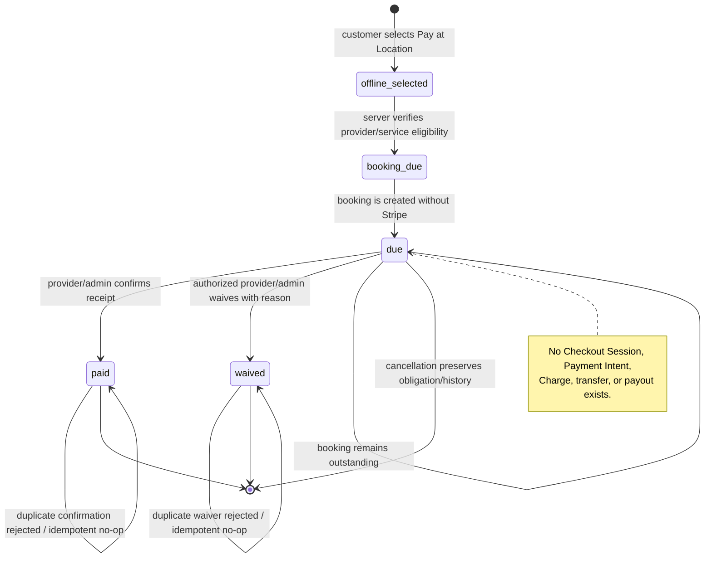

# OlogyCrew Stage 4 — Pay-at-Location Architecture Assessment

**Date:** 2026-11-07  
**Status:** Design and architecture assessment only  
**Checkpoint:** Unpublished; no migration, code, webhook, Stripe, account, payout, or financial-record changes were made.

## Executive recommendation

Introduce Pay-at-Location as a first-class booking payment method that is separate from Stripe. The existing online payment path remains unchanged. An offline booking may reserve a time slot and create a normal booking, but it must not create a Checkout Session, Payment Intent, Charge, Stripe Customer payment attempt, transfer, or payout operation.

The first release should use three offline payment states: `due`, `paid`, and `waived`. Booking lifecycle and payment lifecycle remain independent. The customer can view status but can never confirm their own offline payment.

## 1. Existing schema assessment

### Bookings table

The current `bookings` table already provides the authoritative service reservation and historical amount basis:

- Identity and relationships: `id`, unique `bookingNumber`, `customerId`, `providerId`, and `serviceId`.
- Booking lifecycle: `status` is `pending | confirmed | in_progress | completed | cancelled | no_show | refunded`.
- Scheduling: date, start/end time, duration, booking type, recurring-session relationships, location, venue, and notes.
- Financial values: `subtotal`, `travelFee`, `platformFee`, `totalAmount`, `depositAmount`, and `remainingAmount`.
- Cancellation history: `cancellationReason`, `cancelledBy`, and `cancelledAt`.
- Lifecycle timestamps: `confirmedAt`, `startedAt`, `completedAt`, `createdAt`, and `updatedAt`.

`totalAmount` is the best existing candidate for the original quoted booking amount. However, it is not sufficient by itself for offline settlement because it does not record who confirmed receipt, the offline method, a waiver reason, or a historical immutable snapshot after later booking edits. `remainingAmount` describes the current balance and must not be repurposed as an offline payment ledger.

### Payments table

The current `payments` table is Stripe-oriented but has reusable structural pieces:

- Relationship: `bookingId` references the booking.
- Payment classification: `paymentType` is `deposit | final | full | refund`.
- Amount and currency: `amount`, `currency`, and `refundAmount`.
- Online lifecycle: `status` is `pending | authorized | captured | failed | refunded | cancelled`.
- Stripe references: `stripePaymentIntentId`, `stripeChargeId`, and `stripeRefundId`.
- Existing method text: `paymentMethod` is a nullable varchar and could represent `card` or another online method, but it is not currently a controlled offline state and should not be overloaded without a compatibility review.
- History and failure fields: `failureReason`, `refundReason`, `processedAt`, `refundedAt`, and `createdAt`.

The existing Stripe payment row should remain the online ledger. An offline booking should not be represented as a fake Stripe `pending` or `failed` row, because that would pollute Stripe reconciliation and make a legitimate unpaid-in-person booking look like an online payment failure.

### Audit history

The existing `audit_log` table records actor, action, target type, target ID, JSON details, and timestamp. It is suitable for offline confirmation and waiver audit events after adding explicit action names in the implementation stage. The design must not use a customer-authored field as proof of receipt.

### Reusable versus new data

| Requirement | Existing field or helper | Assessment |
|---|---|---|
| Booking amount basis | `bookings.totalAmount` | Reuse as the source at booking time, but preserve an immutable offline snapshot. |
| Current remaining balance | `bookings.remainingAmount` | Reuse only as a derived/current booking value; do not use as historical receipt evidence. |
| Booking relationship | `payments.bookingId` | Reuse only if offline records are explicitly distinguished from Stripe records; a separate offline ledger is safer. |
| Currency | `payments.currency` | Reuse the same three-letter currency convention. |
| Payment method | `payments.paymentMethod` | Existing free-text field is too weak for offline policy and reporting; do not silently overload it. |
| Actor/timestamp history | `audit_log.actorId`, `createdAt`, `details` | Reuse for immutable confirmation and waiver audit entries. |
| Stripe references | `stripePaymentIntentId`, `stripeChargeId` | Must remain null for Pay-at-Location. |
| Offline receipt and waiver details | None | Requires a small additive offline payment record or a carefully separated extension. |

## 2. State diagrams

### Booking lifecycle

### Online Stripe payment lifecycle

### Pay-at-Location payment lifecycle

### Isolation invariants

1. The payment method is selected and validated server-side before booking creation.
2. An offline booking creates no Stripe identifier and no online payment row.
3. Stripe webhook handlers process only Stripe-linked records and cannot transition an offline record.
4. Offline `paid` and `waived` transitions are available only to the booking provider or an authorized administrator.
5. Customer-facing procedures are read-only for offline payment status.
6. A booking cancellation changes booking state only; it does not erase offline payment history.

## 3. Existing API and route inventory

### Booking and booking-status procedures

The main application router exposes `booking` from `server/routers/bookingRouter.ts`. The current booking router includes:

- Booking creation paths using `createBookingWithCalendarGuard`, including direct/customer, quote-conversion, and related booking flows.
- `myBookings` and booking detail/read procedures.
- Booking status updates with provider/customer/admin authorization.
- Cancellation and rescheduling paths.
- Availability and date-range reads used to protect schedule capacity.

`server/routers/providerRouter.ts` also creates bookings for provider-side workflows through the same calendar guard. `customerHomeRouter.get` provides customer-facing booking summaries. The public agent API intentionally does not create bookings or collect payments; its transaction policy must remain unchanged.

### Current online payment procedures

- `stripe.createCheckoutSession`: customer-owned booking Checkout creation; it performs payment authorization, provider eligibility, velocity checks, credit handling, Customer reuse, and Stripe idempotency.
- `stripe.previewCreditDiscount`: read-only preview for a booking payment.
- `invoice.getPaymentLink`: customer invoice Stripe Checkout.
- `promotion.createCheckout`: provider promotion Stripe Checkout.
- `subscription.createCheckout`: provider subscription Stripe Checkout.
- `customerSubscription.createCheckout`: customer subscription Stripe Checkout.
- Stripe Connect onboarding/status/balance procedures: provider account setup and status; unaffected by Pay-at-Location.
- `stripeWebhook` HTTP handler: signature verification, durable event ledger, and online side effects.

### Minimum new or modified procedures for Stage 4 implementation

No procedures are being added in this design-only checkpoint. The minimum implementation boundary should be:

1. `provider.getPayAtLocationSettings` — provider-only read of enabled flag, eligible services, instructions, and optional policy fields.
2. `provider.updatePayAtLocationSettings` — provider-only mutation; validates ownership, active provider state, and supported services; audit the change.
3. Existing booking creation procedure(s) — add a server-validated `paymentMethod: online | pay_at_location` input or equivalent. The offline branch calls the same calendar guard but bypasses all Stripe creation.
4. `booking.getPaymentStatus` — customer/provider/admin read, scoped to the booking participants; returns method, state, original amount due, current amount due, and safe history.
5. `provider.confirmOfflinePayment` — provider-owned mutation requiring booking ownership, offline method, received amount, and explicit confirmation. Must use an atomic state transition from `due` to `paid`.
6. `admin.confirmOfflinePayment` — optional separate admin mutation or shared authorized service; never expose a customer path to this capability.
7. `provider.waiveOfflinePayment` / `admin.waiveOfflinePayment` — authorized mutation requiring a non-empty reason and waiver amount; atomic `due` to `waived` transition.
8. Existing customer booking-history/detail procedures — extend read models to show offline method and status without adding customer mutation capability.

No public agent endpoint should gain booking or payment authority as part of Stage 4.

## 4. Smallest additive migration proposal

### Preferred design: separate offline payment ledger

Add one new table, tentatively `offline_booking_payments`, with one unique row per booking that uses Pay-at-Location:

- `id` — primary key.
- `bookingId` — unique foreign key to `bookings.id`.
- `paymentMethod` — controlled `pay_at_location` marker.
- `status` — `due | paid | waived`.
- `originalAmountDue` — immutable decimal snapshot copied from the authoritative booking total at creation.
- `amountReceived` — decimal, null/zero until paid; must not exceed policy-defined amount without explicit admin handling.
- `paidAt` — nullable timestamp.
- `confirmedByUserId` — nullable foreign key to the provider/admin user who confirmed receipt.
- `offlinePaymentMethod` — controlled value such as `cash`, `bank_transfer`, `mobile_money`, `other`; the first release should use a small allowlist.
- `paymentNote` — optional sanitized note.
- `waiverAmount` — decimal, null/zero unless waived.
- `waiverReason` — nullable text, required for `waived`.
- `waivedByUserId` — nullable provider/admin foreign key.
- `waivedAt` — nullable timestamp.
- `createdAt`, `updatedAt` — standard timestamps.
- Optional `version` or use `updatedAt` in the conditional update to protect stale concurrent actions.

This avoids corrupting the existing Stripe payment ledger and makes reporting separation explicit. It also avoids adding many nullable offline columns to every historical `payments` row.

### Booking-level configuration

Provider settings should be stored separately from the payment record, ideally in an existing provider-settings area if one exists. If no compatible settings table exists, the smallest additive configuration should be a provider-level settings table or a small provider settings extension containing:

- `payAtLocationEnabled`.
- `payAtLocationInstructions`.
- Eligible service IDs in a normalized child table rather than a JSON blob.

The assessment does not apply this migration because the user requested design only.

### Backward compatibility

- Existing bookings remain unchanged and are interpreted as online/legacy according to their existing payment rows.
- Existing Stripe payments retain all current Stripe IDs, statuses, refunds, and webhook behavior.
- No historical booking is retroactively classified as offline.
- New offline rows are created only when the new payment method is explicitly selected and server-validated.
- Existing `totalAmount` is copied into `originalAmountDue` at offline booking creation; later edits do not rewrite the historical snapshot.
- Offline collections are excluded from Stripe revenue, fee, transfer, payout, and reconciliation queries by table boundary and explicit reporting tests.

### Rollback strategy

Because the migration is additive, rollback is operationally safe if performed in stages:

1. Disable the Pay-at-Location provider setting and stop accepting new offline bookings.
2. Keep existing offline rows read-only so history remains visible.
3. Remove or disable only the new procedures and UI paths after confirming no in-flight offline confirmation request remains.
4. Do not delete offline history as part of a rollback.
5. If a physical table rollback is ever required, export the offline table and audit records first, then remove only the newly created tables/constraints through a reviewed migration. Existing `bookings`, `payments`, Stripe records, and financial tables must not be altered.

## 5. Interface design proposal

### Customer booking flow

- Add a payment-method choice only when the provider has enabled Pay-at-Location for the selected service.
- Present two explicit cards: `Pay online` and `Pay at location`.
- For offline selection, show provider instructions, when payment is due, accepted offline methods, and a clear notice that no card is collected online.
- Confirm the booking independently of payment collection.
- In booking history/detail, show `Payment due at location`, original amount due, and instructions.
- For `paid`, show the confirmation timestamp and provider-confirmed label.
- For `waived`, show that the obligation was waived without exposing internal administrative notes unless appropriate.
- Do not render a customer “Mark as paid” or “Confirm payment” control.

### Provider workspace

- Add a Pay-at-Location settings card with enable/disable, eligible services, instructions, and optional accepted-method choices.
- Add an outstanding offline payments view filtered to the provider’s bookings.
- Add `Mark as paid` only for eligible `due` rows. The confirmation dialog must display booking, amount due, received amount, method, optional note, and a warning that this action records provider-confirmed receipt.
- Add `Waive payment` only for authorized provider/admin roles. Require amount and reason; present the action as an exception, not a normal collection path.
- After either action, invalidate the booking/payment queries and show the immutable audit outcome.

### Admin workspace

- Add privacy-safe offline payment counts and outstanding totals separate from Stripe payment-security metrics.
- Provide read-only history and a controlled waiver/confirmation path only for authorized administrators.
- Label offline collections as non-Stripe activity so they cannot be confused with Connect transfers or recovery debits.

## 6. Acceptance test plan before implementation

### Schema and historical values

- New offline booking snapshots `originalAmountDue` from the authoritative booking total.
- Later booking edits do not rewrite `originalAmountDue`.
- Offline receipt records received amount, method, timestamp, and confirming actor.
- Waiver requires amount, reason, authorizing actor, and timestamp.
- Existing Stripe payment rows and historical bookings remain byte-for-byte unchanged by the migration.

### Stripe isolation

- Selecting Pay-at-Location creates no Checkout Session, Payment Intent, Charge, Stripe Customer payment attempt, transfer, or payout.
- Selecting online payment follows the existing Stripe route and idempotency behavior unchanged.
- Stripe webhook events cannot create, update, or mark an offline row paid.
- Offline rows have null Stripe identifiers and never enter Stripe reconciliation, fee, transfer, or payout calculations.

### Authorization

- Provider can configure only their own provider settings.
- Provider can confirm only a booking belonging to that provider.
- Admin can confirm/waive only through the admin-authorized procedure.
- A customer cannot confirm, waive, or alter offline payment status, even for their own booking.
- A provider cannot mark an online Stripe payment as offline paid.

### State and concurrency

- `due -> paid` succeeds once; a second confirmation is rejected or returns an idempotent already-paid result without creating a second receipt.
- `due -> waived` requires a non-empty reason.
- `paid -> waived`, `waived -> paid`, and changes to a settled row are rejected unless a separately approved correction workflow exists.
- Concurrent confirmation requests produce one effective transition and one receipt/audit outcome.
- A stale confirmation or waiver request fails if the row changed during review.
- Booking cancellation preserves the offline row and its history.

### UI and reporting

- Customer sees due/paid/waived status but no self-confirmation control.
- Provider sees only their own outstanding offline obligations.
- Admin sees offline and online totals in separate sections.
- Payment-security monitoring does not treat `due` as a failed online payment.
- Export/reconciliation tests prove offline amounts are excluded from Stripe fees, transfers, payouts, and Connect balance calculations.

## 7. Scope and protection confirmation

This assessment made no production changes. It did not apply a migration, alter webhook behavior, change Stripe settings, rotate credentials, modify connected accounts or payouts, issue refunds, or alter existing financial records. Incident evidence and temporary restrictions are preserved. Chisolm Audio and Gary Studios are unaffected.

Implementation should begin only after explicit approval of this design and a separate unpublished implementation checkpoint.
